# OrganelleFix
A Nextflow pipeline for organellar genome analysis.

# Usage

## Install Nextflow via Conda.
## Ensure Docker is installed and running on your system.
## Build `samples_table`

## Samples Configuration File (-samples_table)

The `-samples_table` input file controls the execution of the **OrganelleFix** pipeline. It allows defining organellar samples and supports two alternative data delivery methods (GenBank **or** FASTA + BED).

## Column Description:
* **`sample_id`**: Unique identifier for the sample or species (used in output folder names).
* **`organelle`**: Type of organellar genome (e.g., `plastome` or `mitogenome`).
* **`comparison_group`**: Comparative or taxonomic group (e.g., `Brassicaceae`), useful for downstream bulk analyses.
* **`fasta_path`**: Path to the genome FASTA file (required in FASTA+BED mode; leave empty if using a GenBank file).
* **`gbk_path`**: Path to the GenBank `.gb` file (required in GBK mode; leave empty if using the FASTA + BED pair).
* **`bed_path`**: Path to the annotations BED file (required in FASTA+BED mode; leave empty if using a GenBank file).

---

## Example Content of `-samples_table`:

```csv
sample_id,organelle,comparison_group,fasta_path,gbk_path,bed_path
Species_1,plastome,Group_A,,data_test/Species_1_plastome.gb,
Species_1,mitogenome,Group_A,,data_test/Species_1_mitogenome.gb,
Species_2,plastome,Group_A,,data_test/Species_2_plastome.gb,
Species_2,mitogenome,Group_A,,data_test/Species_2_mitogenome.gb,
Species_3,plastome,Group_B,/path/to/Species_3_plastome.fasta,,/path/to/Species_3_plastome.bed
Species_3,mitogenome,Group_B,/path/to/Species_3_mitogenome.fasta,,/path/to/Species_3_mitogenome.bed
```

## Example Content of `-bed_path`:

```csv
genome	5000	5400	rrn26	rRNA	+
genome	35000	35400	ccmB	CDS	+
genome	35500	36000	cox2	CDS	+
genome	122000	122300	tRNA-Ser	tRNA	+
```

## Run pipeline

## Pipeline Parameters

- **`--samples_table`** (`file`, required): Path to input CSV samples sheet.
- **`--ks_ka_reference_plastome`** (`file`, optional): Reference plastome sequence for Ka/Ks analysis.
- **`--ks_ka_reference_mitogenome`** (`file`, optional): Reference mitogenome sequence for Ka/Ks analysis.
- **`--outgroup_plastome`** (`file`, optional): Outgroup sequence for plastome phylogenetic tree building.
- **`--outgroup_mitogenome`** (`file`, optional): Outgroup sequence for mitogenome phylogenetic tree building.

``` bash
nextflow run mordziarz/OrganelleFix -profile standard  --samples_table samples_table.csv -profile standard --ks_ka_reference_plastome "species" --ks_ka_reference_mitogenome "species" --outgroup_plastome "species" --outgroup_mitogenome "species"
```
# WARNING
The pipeline does **not** automatically validate the number of CDS features, nor whether they start and end correctly. It is **strongly recommended** to inspect all output files in the `results/prepared_genomes` folder. While downstream analyses based on nucleotide sequences are generally robust, verifying the correct CDS boundaries for your dataset is essential.

# Results

```text
results/
├── kaks/
├── phylogeny/
├── prepared_genomes/
├── repeats/
├── rna_editing/
├── rscu_results/
├── ssr/
└── transgenomes_results/
```

## RSCU Analysis

### Example Output: RSCUcaller Results

| Species | Lys \| aaa | Asn \| aac | Thr \| aca | Met \| atg | Ala \| gct | ...  |
| :--- | :---: | :---: | :---: | :---: | :---: | :---: |
| **Rorippa_indica_plastome** | 1.5208 | 0.4474 | 1.2222 | 1.0000 | 1.8901 | ... |
| **Descurainia_sophia_plastome** | 1.5424 | 0.4556 | 1.2154 | 1.0000 | 1.8500 | ... |
| **Capsella_bursa_pastoris_plastome** | 1.5745 | 0.4871 | 1.2383 | 1.0000 | 1.9042 | ... |

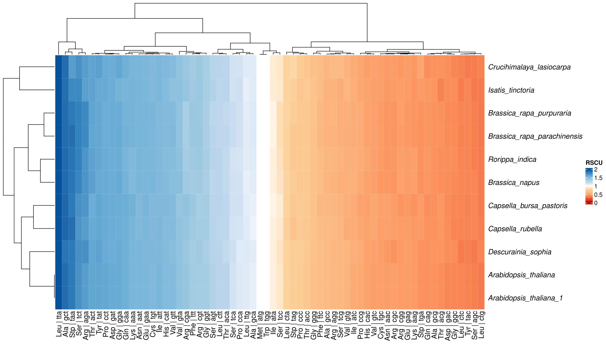

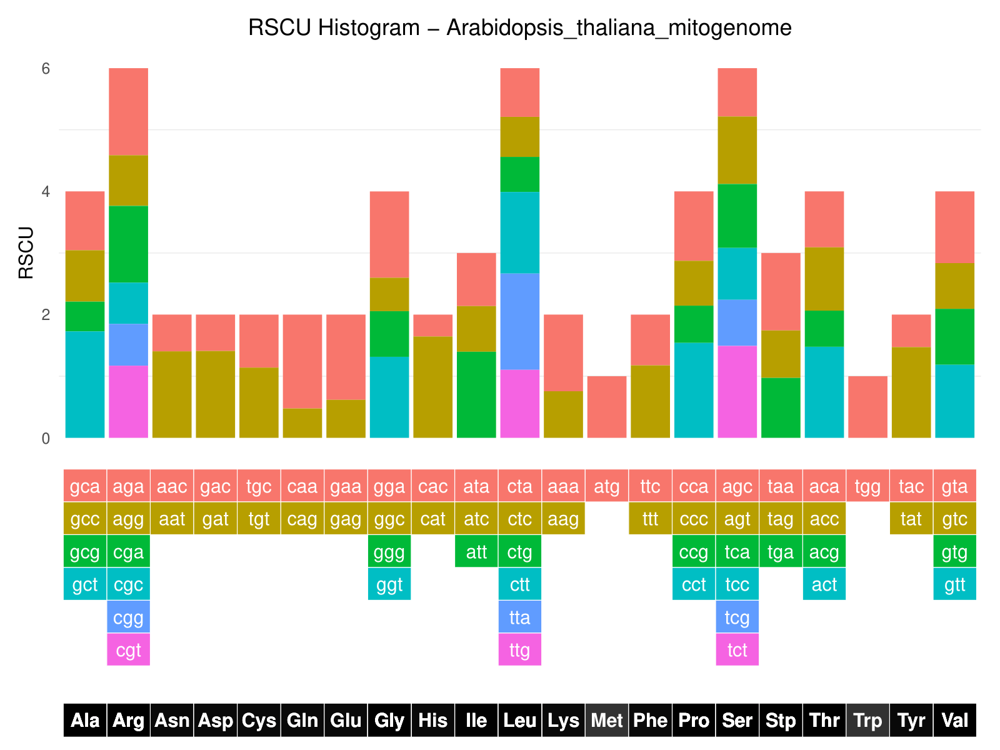

## SSR Analysis

### Example Output: SSR Analysis Results

| ID | Class | Base | Start | End | Len | Count | SSR | Gene_Context | Species |
| :--- | :---: | :---: | :---: | :---: | :---: | :---: | :--- | :--- | :--- |
| JF729200.1 | Tetra | TTCT | 2934 | 2945 | 12 | 3 | TTCTTTCTTTCT | Intergenic (Start - rrn26) | Arabidopsis_thaliana_1_mitogenome |
| JF729200.1 | Penta | CATTC | 3007 | 3021 | 15 | 3 | CATTCCATTCCATTC | Intergenic (Start - rrn26) | Arabidopsis_thaliana_1_mitogenome |
| JF729200.1 | Tri | GAA | 8507 | 8521 | 15 | 5 | GAAGAAGAAGAAGAA | Intergenic (Start - rrn26) | Arabidopsis_thaliana_1_mitogenome |
| JF729200.1 | Tetra | AATG | 26935 | 26946 | 12 | 3 | AATGAATGAATG | rps3 | Arabidopsis_thaliana_1_mitogenome |
| JF729200.1 | Tetra | ACTC | 29844 | 29855 | 12 | 3 | ACTCACTCACTC | Intergenic (tRNA-Lys - ccmB) | Arabidopsis_thaliana_1_mitogenome |
| JF729200.1 | Di | TC | 34725 | 34736 | 12 | 6 | TCTCTCTCTCTC | Intergenic (ccmB - cox2) | Arabidopsis_thaliana_1_mitogenome |
| JF729200.1 | Tri | TTC | 42771 | 42782 | 12 | 4 | TTCTTCTTCTTC | Intergenic (cox2 - ccmFC) | Arabidopsis_thaliana_1_mitogenome |
| JF729200.1 | Tetra | ACTT | 45720 | 45731 | 12 | 3 | ACTTACTTACTT | Intergenic (cox2 - ccmFC) | Arabidopsis_thaliana_1_mitogenome |

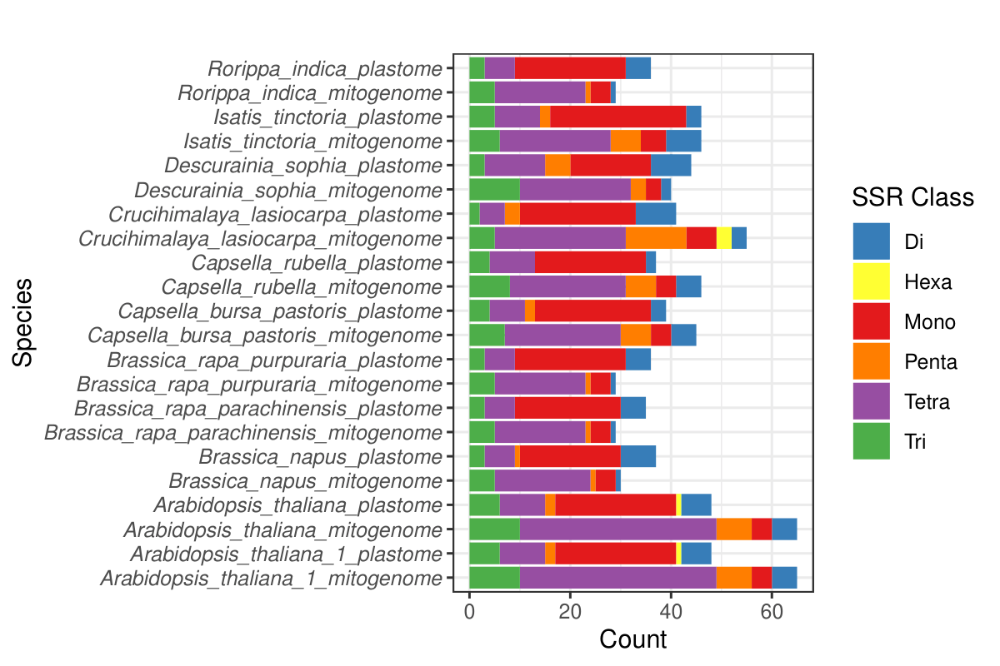

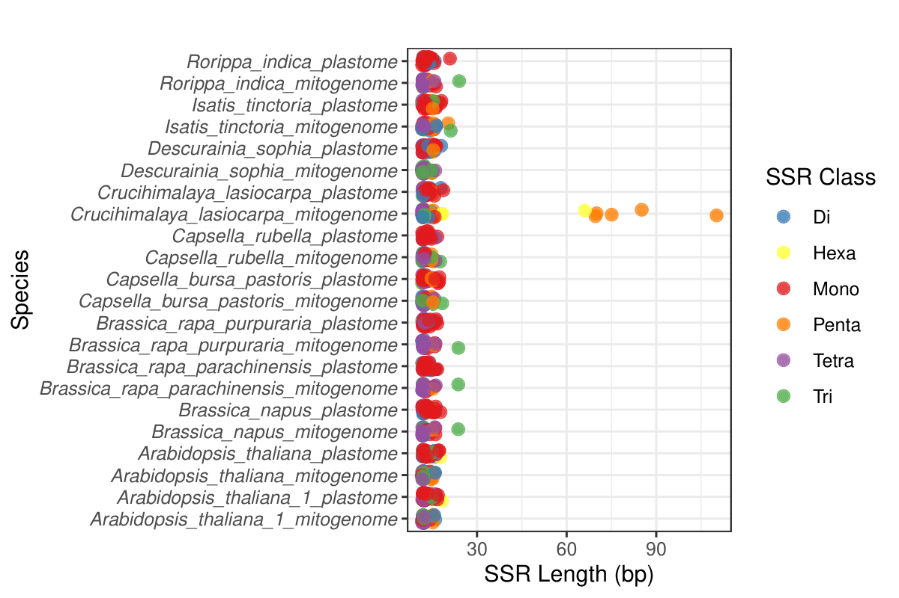

## Repeat Analysis 

| Sequence | Type | Orientation | Start1 | End1 | Start2 | End2 | Length | Identity | Mismatches | GapOpens | Gap | Evalue | BitScore | Context1 | Context2 | Species |
| :--- | :--- | :--- | :--- | :--- | :--- | :--- | :--- | :--- | :--- | :--- | :--- | :--- | :--- | :--- | :--- | :--- |
| JF729200.1 Arabidopsis thaliana ecotype C24 mitochondrion, complete genome | Forward | Direct | 5508 | 5541 | 171706 | 171739 | 34 | 91.176 | 3 | 0 | 166164 | 0.007 | 44.1 | Intergenic (Start - rrn26) | Intergenic (nad4 - atp4) | Arabidopsis_thaliana_1_mitogenome |
| JF729200.1 Arabidopsis thaliana ecotype C24 mitochondrion, complete genome | Forward | Direct | 7557 | 7596 | 35251 | 35287 | 40 | 92.5 | 0 | 1 | 27654 | 2.92e-05 | 52 | Intergenic (Start - rrn26) | Intergenic (ccmB - cox2) | Arabidopsis_thaliana_1_mitogenome |
| JF729200.1 Arabidopsis thaliana ecotype C24 mitochondrion, complete genome | Forward | Direct | 7867 | 7896 | 122376 | 122405 | 30 | 100 | 0 | 0 | 114479 | 1.2e-07 | 60 | Intergenic (Start - rrn26) | Intergenic (tRNA-Ser - tRNA-Ile) | Arabidopsis_thaliana_1_mitogenome |
| JF729200.1 Arabidopsis thaliana ecotype C24 mitochondrion, complete genome | Forward | Direct | 7867 | 7896 | 161067 | 161096 | 30 | 96.667 | 1 | 0 | 153170 | 2.92e-05 | 52 | Intergenic (Start - rrn26) | Intergenic (rpl2 - nad4) | Arabidopsis_thaliana_1_mitogenome |
| JF729200.1 Arabidopsis thaliana ecotype C24 mitochondrion, complete genome | Forward | Direct | 7867 | 7896 | 206426 | 206455 | 30 | 100 | 0 | 0 | 198529 | 1.2e-07 | 60 | Intergenic (Start - rrn26) | Intergenic (tRNA-Lys - cox3) | Arabidopsis_thaliana_1_mitogenome |
| JF729200.1 Arabidopsis thaliana ecotype C24 mitochondrion, complete genome | Forward | Direct | 8424 | 8488 | 278833 | 278897 | 65 | 93.846 | 4 | 0 | 270344 | 5.5e-19 | 97.6 | Intergenic (Start - rrn26) | Intergenic (tRNA-Asp - atp9) | Arabidopsis_thaliana_1_mitogenome |
| JF729200.1 Arabidopsis thaliana ecotype C24 mitochondrion, complete genome | Forward | Direct | 8456 | 8488 | 346713 | 346745 | 33 | 96.97 | 1 | 0 | 338224 | 4.73e-07 | 58 | Intergenic (Start - rrn26) | Intergenic (tRNA-met - cox1) | Arabidopsis_thaliana_1_mitogenome |
| JF729200.1 Arabidopsis thaliana ecotype C24 mitochondrion, complete genome | Forward | Direct | 11710 | 11740 | 188825 | 188855 | 31 | 93.548 | 2 | 0 | 177084 | 0.002 | 46.1 | Intergenic (rrn26 - nad5) | Intergenic (atp4 - nad4L) | Arabidopsis_thaliana_1_mitogenome |

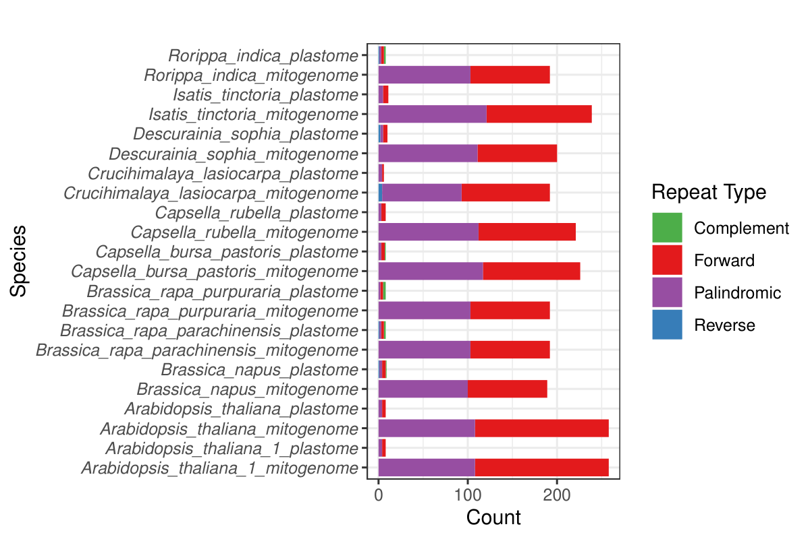

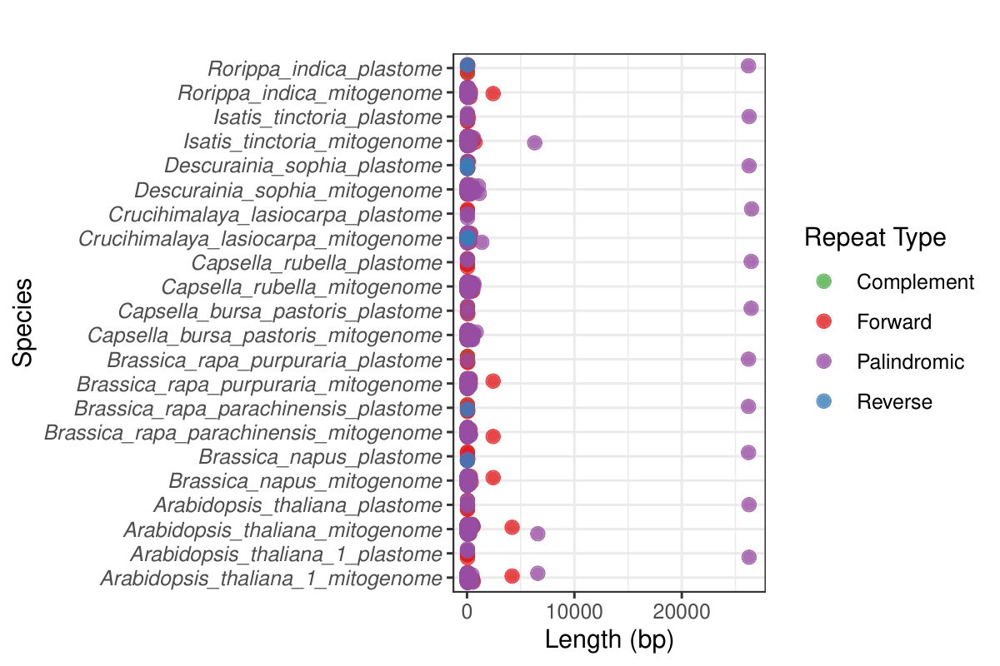

## Ka/Ks Analysis

### Example Output: Ka/Ks Results

| gene | parameter | Functional_Category | Rorippa_indica | Descurainia_sophia | Capsella_bursa_pastoris | Brassica_rapa_purpuraria | Crucihimalaya_lasiocarpa | Arabidopsis_thaliana | Arabidopsis_thaliana_1 | Capsella_rubella | Brassica_rapa_parachinensis | Isatis_tinctoria | Brassica_napus |
| :--- | :--- | :--- | :--- | :--- | :--- | :--- | :--- | :--- | :--- | :--- | :--- | :--- | :--- |
| accd | Ka | Other genes | 0.00076 | 0.02385 | 0.03664 | 0.00076 | 0.02924 | 0.0348 | 0.0348 | 0.03666 | 0.00076 | 0.01801 | 0 |
| accd | Ks | Other genes | 0 | 0.04075 | 0.07885 | 0 | 0.03537 | 0.0719 | 0.0719 | 0.08002 | 0 | 0.02934 | 0 |
| accd | Ka/Ks | Other genes | 0 | 0.5852 | 0.4647 | 0 | 0.8267 | 0.4841 | 0.4841 | 0.4582 | 0 | 0.614 | 0 |

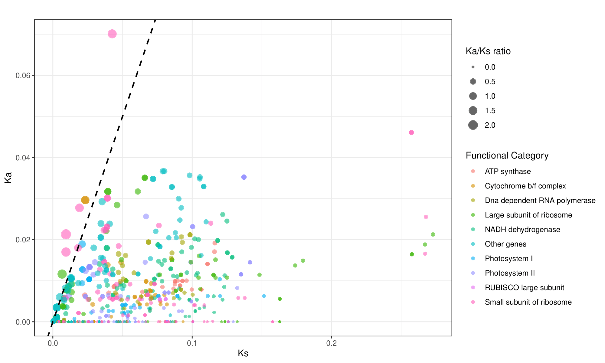

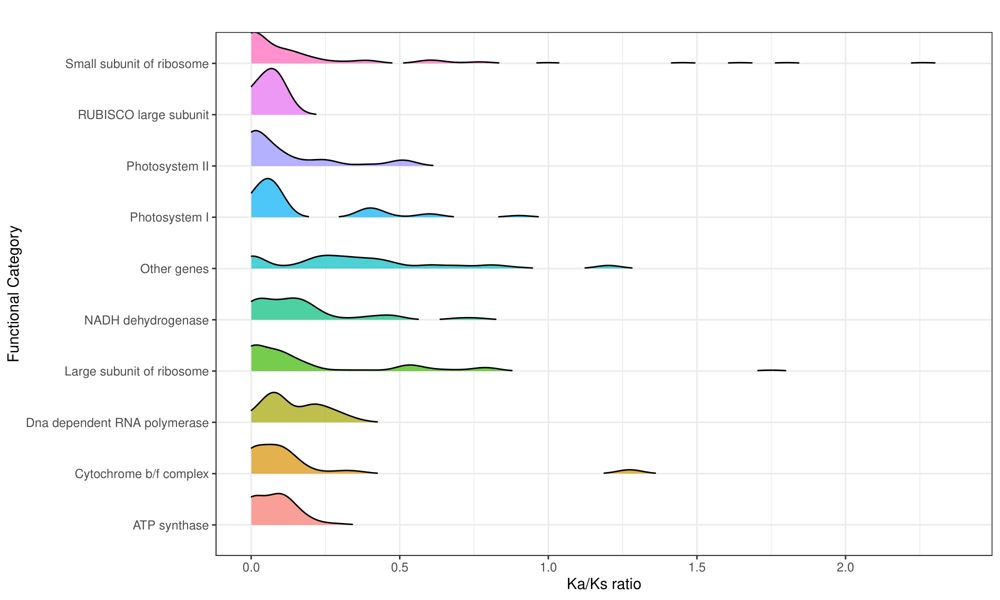

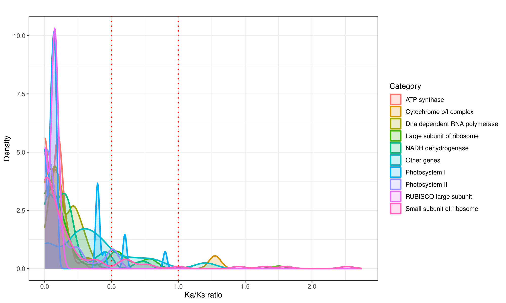

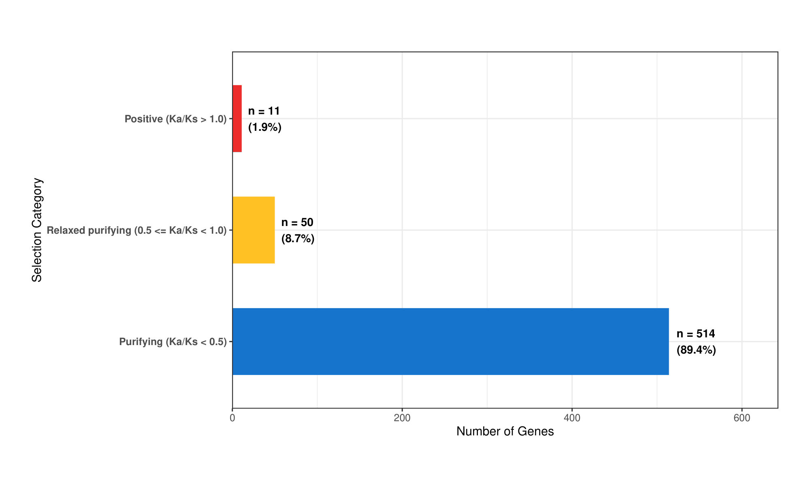

## Phylogenetic Tree (CDS-based)

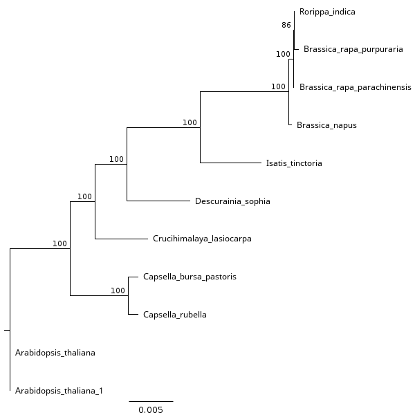

## RNA Editing Prediction

### Example Output: RNA Editing Results

| gene | codon_position | nucleotide_position | original_codon | edited_codon | original_aa | edited_aa | type | confidence_score |
| :--- | :---: | :---: | :---: | :---: | :---: | :---: | :---: | :--- |
| psbA | 1 | 2 | ATG | ACG | M | T | U-to-C | Moderate |
| psbA | 2 | 5 | ACT | ATT | T | I | C-to-U | High |
| psbA | 3 | 8 | GCA | GTA | A | V | C-to-U | High |
| psbA | 4 | 11 | ATT | ACT | I | T | U-to-C | Moderate |
| psbA | 5 | 14 | TTA | TCA | L | S | U-to-C | Moderate |
| psbA | 8 | 22 | CGC | TGC | R | C | C-to-U | Moderate |
| psbA | 13 | 38 | CTA | CCA | L | P | U-to-C | Moderate |
| psbA | 14 | 40 | TGG | CGG | W | R | U-to-C | Moderate |

## Organellar Transfers (Mitogenome vs. Plastome)

### Example Output: Transgenomes Results

| mt_id | pt_id | perc_identity | num_ident_matches | alig_length | mismatches | gap_openings | n_gaps | pos_match | ppos | mt_start | mt_end | mt_total_len | qcov | qcovhsp | pt_start | pt_end | pt_total_len | evalue | bit_score | score_raw | mt_genes | pt_genes | direction |
| :--- | :--- | :---: | :---: | :---: | :---: | :---: | :---: | :---: | :---: | :---: | :---: | :---: | :---: | :---: | :---: | :---: | :---: | :---: | :---: | :---: | :--- | :--- | :--- |
| JF729200.1 | OP474144.1 | 96.805 | 909 | 939 | 15 | 4 | 15 | 909 | 96.81 | 105009 | 105941 | 366922 | 2 | 0 | 109937 | 109008 | 154478 | 0 | 1554 | 1723 | tRNA-Asn (g_len=62, ov_len=62, g_perc=100%, t_perc=6.6%) | trnN-GUU (g_len=72, ov_len=72, g_perc=100%, t_perc=7.7%); ycf1 (g_len=1029, ov_len=530, g_perc=51.5%, t_perc=56.4%) | PT -> MT |
| JF729200.1 | OP474144.1 | 96.805 | 909 | 939 | 15 | 4 | 15 | 909 | 96.81 | 105009 | 105941 | 366922 | 2 | 0 | 128712 | 129641 | 154478 | 0 | 1554 | 1723 | tRNA-Asn (g_len=62, ov_len=62, g_perc=100%, t_perc=6.6%) | ycf1 (g_len=5358, ov_len=529, g_perc=9.9%, t_perc=56.3%); trnN-GUU (g_len=72, ov_len=72, g_perc=100%, t_perc=7.7%) | PT -> MT |
| JF729200.1 | OP474144.1 | 97.038 | 557 | 574 | 11 | 2 | 6 | 557 | 97.04 | 77540 | 78108 | 366922 | 2 | 0 | 56072 | 55500 | 154478 | 0 | 956 | 1059 | none | rbcL (g_len=1440, ov_len=572, g_perc=39.7%, t_perc=99.7%) | PT -> MT |
| JF729200.1 | OP474144.1 | 99.608 | 508 | 510 | 1 | 1 | 1 | 508 | 99.61 | 364676 | 365185 | 366922 | 2 | 0 | 105187 | 105695 | 154478 | 0 | 908 | 1006 | none | rrn23S (g_len=2810, ov_len=508, g_perc=18.1%, t_perc=99.6%) | Unidentified |
| JF729200.1 | OP474144.1 | 99.608 | 508 | 510 | 1 | 1 | 1 | 508 | 99.61 | 364676 | 365185 | 366922 | 2 | 0 | 133462 | 132954 | 154478 | 0 | 908 | 1006 | none | rrn23S (g_len=2810, ov_len=508, g_perc=18.1%, t_perc=99.6%) | Unidentified |
| JF729200.1 | OP474144.1 | 95.257 | 482 | 506 | 12 | 3 | 12 | 482 | 95.26 | 334343 | 334837 | 366922 | 2 | 0 | 898 | 394 | 154478 | 0 | 802 | 889 | none | psbA (g_len=1062, ov_len=504, g_perc=47.5%, t_perc=99.6%) | PT -> MT |

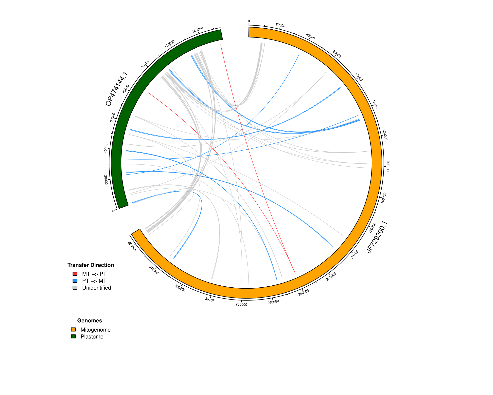

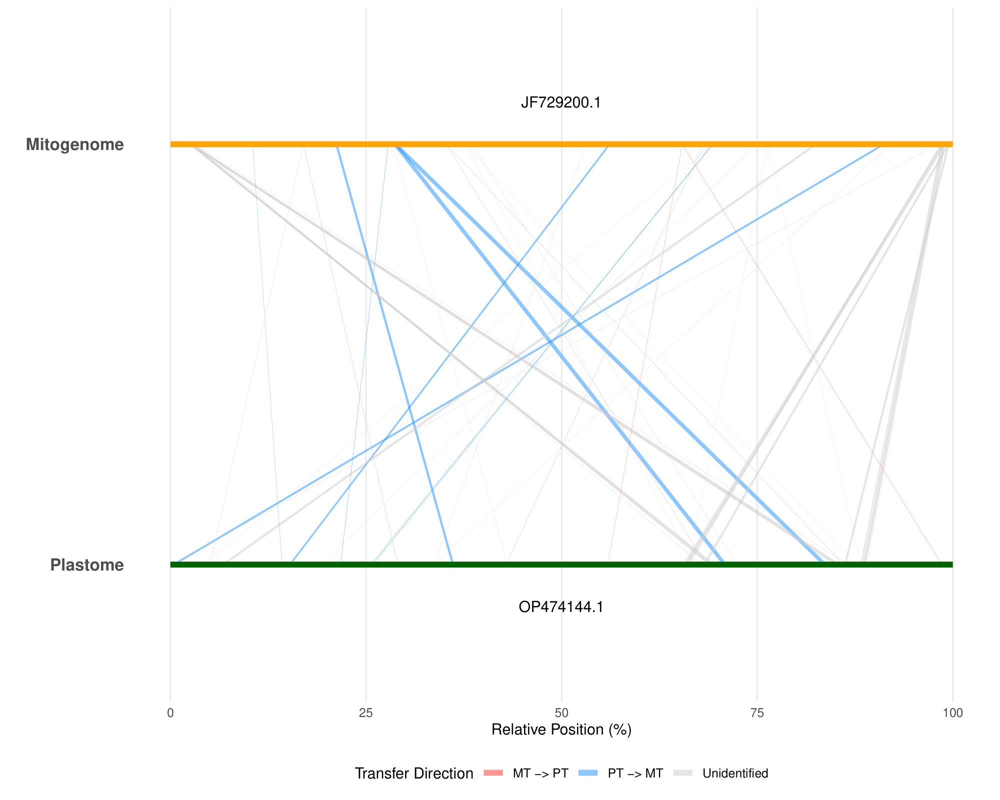

# Citation

If you use **OrganelleFix** in your research, please cite the underlying tools and software packages integrated into this pipeline:

- **RSCU Analysis:** RSCUcaller ([10.1186/s12859-025-06166-5](https://doi.org/10.1186/s12859-025-06166-5))
- **Transfer Analysis:** transgenomes ([10.1007/s10265-026-01709-0](https://doi.org/10.1007/s10265-026-01709-0))
- **Phylogenetic Analysis:** IQ-TREE ([10.1093/molbev/msag117](https://doi.org/10.1093/molbev/msag117))
- **Alignment:** MAFFT ([10.1093/nar/gkf436](https://doi.org/10.1093/nar/gkf436))
- **Visualization:** ggplot2 ([10.1007/978-3-319-24277-4](https://doi.org/10.1007/978-3-319-24277-4))

> *Note:* A dedicated scientific publication for **OrganelleFix** is currently in preparation.